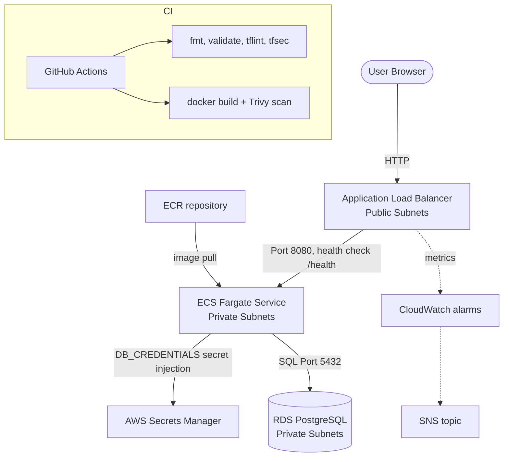

# AWS ECS Fargate Backend API


Terraform reference project: a small Python API on Amazon ECS Fargate behind an Application Load Balancer, backed by PostgreSQL on Amazon RDS, with database credentials injected from AWS Secrets Manager and CloudWatch alarms. CI is configured to validate the Terraform and to build and scan the container image. The stack is configured to be destroyed with one `terraform destroy`.

## Verified

One deployment in us-east-1 on 2026-10-20, then destroyed. Each item states only what the linked file shows.

- **Endpoints through the ALB:** `GET /health` returned 200 ([08-health.txt](docs/evidence/08-health.txt)) and `GET /db-check` returned 200 ([09-db-check.txt](docs/evidence/09-db-check.txt)). `/db-check` read `DB_CREDENTIALS`, injected from Secrets Manager, and ran `SELECT 1`.
- **Service state:** the ECS service was ACTIVE with 1 of 1 tasks running ([06-services-stable.txt](docs/evidence/06-services-stable.txt)) and the target was healthy ([07-target-health.txt](docs/evidence/07-target-health.txt)).
- **Local container test:** the image ran as non-root (uid 999), `GET /health` returned 200 and `GET /db-check` returned 503 without a database, as expected ([00-local-docker.txt](docs/evidence/00-local-docker.txt)).
- **Manual alarm test:** `alb-unhealthy-hosts-production` went OK -> ALARM -> OK ([10-alarm-manual-test.txt](docs/evidence/10-alarm-manual-test.txt)).
- **Real trigger:** a bad health check path made the target unhealthy at 14:42:43 local time (UTC+2), and `alb-unhealthy-hosts-production` went OK -> ALARM at about 14:45 without `set-alarm-state` ([11b-real-trigger-bad-path.txt](docs/evidence/11b-real-trigger-bad-path.txt), [12-alarm-history.txt](docs/evidence/12-alarm-history.txt)). After `/health` was restored a healthy target appeared, but the alarm return to OK was **not observed**: the stack was destroyed afterwards.
- **Other alarms:** the other four alarms exist and stayed OK; they were not triggered ([12-alarm-history.txt](docs/evidence/12-alarm-history.txt)).
- **Destroy:** 51 resources destroyed ([13-destroy.txt](docs/evidence/13-destroy.txt)). The leftover check found remains of an earlier deployment ([14-leftovers.txt](docs/evidence/14-leftovers.txt)); they were cleaned manually. Afterwards only 3 KMS keys in PendingDeletion and an unrelated Lambda log group remained ([14b-leftovers-after-cleanup.txt](docs/evidence/14b-leftovers-after-cleanup.txt)).
- **The apply ran in several steps:** the first attempt failed with `ResourceAlreadyExistsException` on a pre-existing log group ([03-apply.txt](docs/evidence/03-apply.txt)); 3 resources were completed in a later apply ([03c-apply.txt](docs/evidence/03c-apply.txt)).
- **CI:** no CI run result is recorded in the evidence, so no CI status is claimed here.

## System Architecture



## What is in the repository

| Path | Content |
|---|---|
| `modules/networking` | VPC, 2 public and 2 private subnets, NAT gateway, ALB, target group, security groups, VPC flow logs |
| `modules/database` | RDS PostgreSQL 15 (single instance), KMS key, Secrets Manager secret with a generated password |
| `modules/ecs` | ECR repository, ECS cluster, task definition, service, IAM roles, log group, autoscaling (present in code, not exercised) |
| `modules/monitoring` | SNS topic and 5 CloudWatch alarms: unhealthy hosts, target 5xx, ECS CPU, RDS CPU, RDS free storage |
| `app/` | Python service (standard library plus `pg8000`): `GET /health`, `GET /db-check` |
| `scripts/` | `push-image.ps1`, `check-leftovers.ps1` |
| `docs/RUNBOOK.md` | Ordered commands to deploy, test, destroy and check leftovers |
| `tests/` | Terratest (see Limitations) |

How it works in the code:

- **Secrets:** the task definition has a `secrets` block with `valueFrom` pointing to the Secrets Manager secret. The container receives the JSON in one environment variable, `DB_CREDENTIALS`. The execution role can read that secret and decrypt it with the KMS key.
- **Endpoints:** `/health` returns 200 without touching the database. `/db-check` connects to RDS, runs `SELECT 1` and returns 200 or 503. It does not log the password.
- **Destroyability:** ECR `force_delete`, RDS without final snapshot, deletion protection and backups, secret without recovery window, Container Insights off (it would create a log group Terraform does not manage).

## Usage

Everything is run by the operator; see [docs/RUNBOOK.md](docs/RUNBOOK.md) for the exact order.

```text
cp terraform.tfvars.example terraform.tfvars   # set allowed_ingress_cidrs to your IP; the file is git-ignored
terraform init
terraform apply
./scripts/push-image.ps1
terraform destroy
```

Terraform state is local (no remote backend) and contains the generated database password. The state file is git-ignored.

After `terraform destroy`, the KMS keys remain in `PendingDeletion` for 7 days. This is expected.

## Security notes (tfsec)

CI runs `tfsec` as a single gate. These findings are suppressed inline, on purpose:

*   `aws-elb-http-not-used`: the ALB listens on HTTP port 80. HTTPS needs an ACM certificate and a domain, which this project does not use.
*   `aws-elb-alb-not-public`: the ALB is public so the service can be reached from a browser without a VPN or bastion. Access is limited by the `allowed_ingress_cidrs` variable.
*   `aws-ec2-no-public-ingress-sgr`: the ALB security group ingress comes from a variable; if you set a public range, the finding applies.
*   `aws-ec2-no-public-egress-sgr`: ECS tasks have egress on 443 to `0.0.0.0/0` (ECR, Secrets Manager and CloudWatch through the NAT gateway).
*   `aws-cloudwatch-log-group-customer-key`: the VPC flow log group uses the default AWS encryption.
*   `aws-iam-no-policy-wildcards`: the flow log policy uses a trailing `:*` on its own log group ARN, required for log streams.
*   `aws-ecs-enable-container-insight`: Container Insights is off so no unmanaged log group survives destroy.
*   `aws-ecr-repository-customer-key`: the ECR repository uses default AWS encryption.
*   `aws-rds-enable-deletion-protection`, `aws-rds-specify-backup-retention`: off so the stack can be destroyed completely.

Credentials: no credentials are in the source files. The generated database password does exist in the Terraform state.

`allowed_ingress_cidrs` has no default; set it in `terraform.tfvars`.

## Limitations

- **Terratest: NOT VERIFIED.** `tests/ecs_backend_test.go` runs a real `apply` and `destroy`, needs AWS credentials, has no `go.mod`, does not pass the required `allowed_ingress_cidrs` variable, and no CI job runs it.
- **Single run:** everything in "Verified" comes from one deployment. Recovery of the alarm to OK after restoring the health check was not observed.
- **Deployment role:** the deployment used an assumable role with service-level wildcard permissions in us-east-1, configured manually outside this repository.
- **Not exercised:** autoscaling and the other four alarms.
- HTTP only, no TLS. The ALB is public.
- RDS is a single instance (`multi_az` is not set). Subnets span two AZs, but the service runs one task. No automated backups.
- The app connects to RDS over TLS without verifying the server certificate.
- Autoscaling policies exist in the code and have not been exercised.
- CI does not run `terraform apply` and has no AWS credentials. The Trivy scan runs only on the built image, not on the deployed one.
- Terraform state is local.
